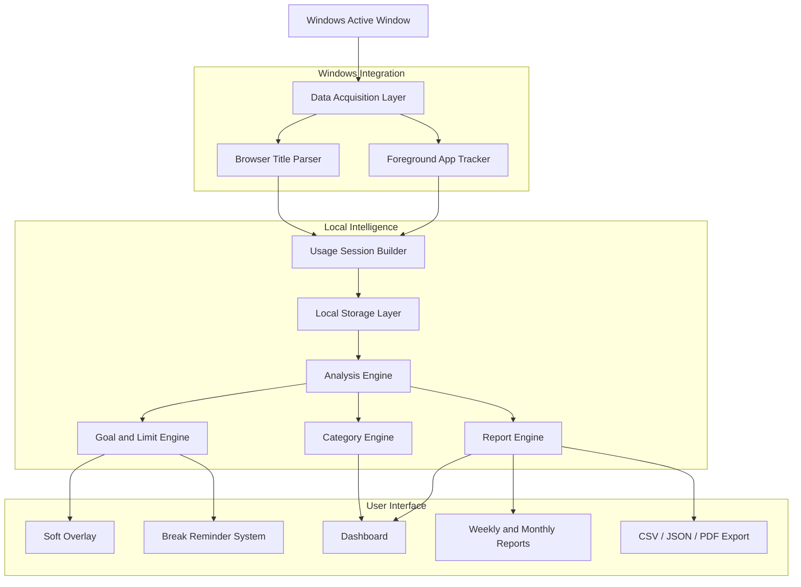
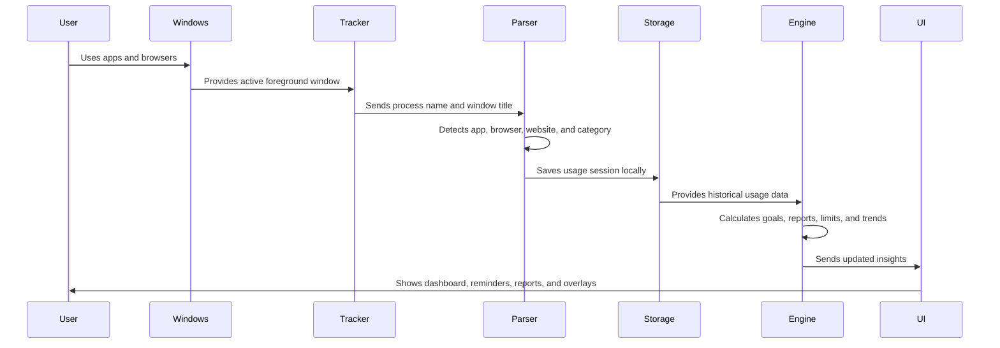
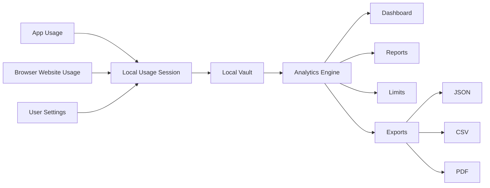
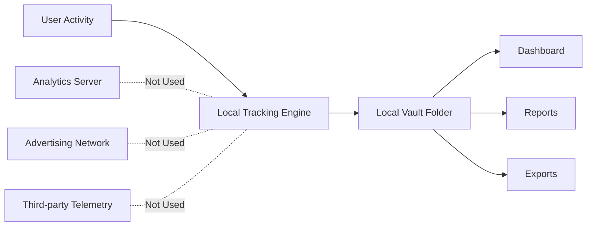
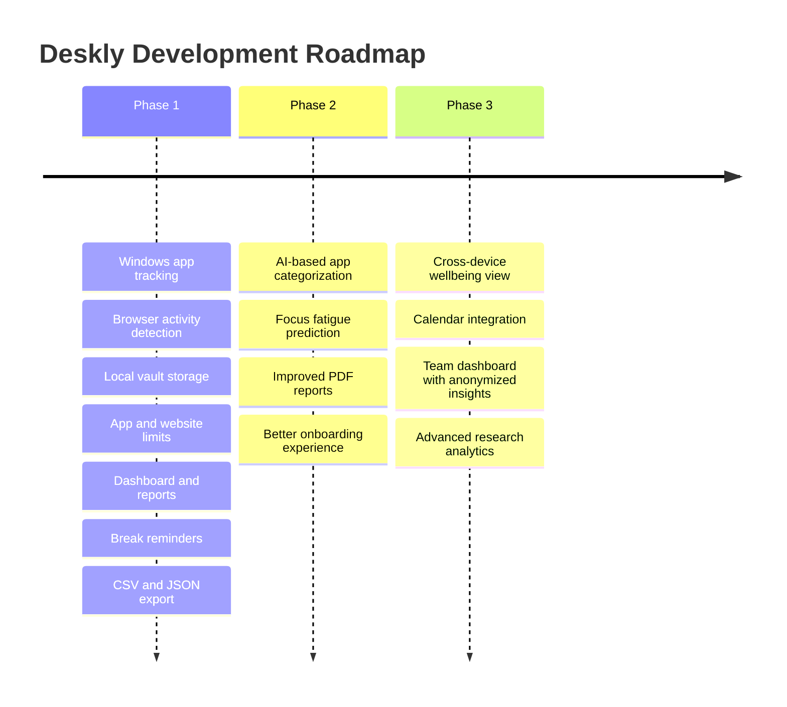

<div align="center">


<br/>

<p>
  
  
  
  
</p>

<p>
  
  
  
  
</p>

<br/>

<a href="https://www.deskly.in/" target="_blank">
  
</a>
<a href="https://www.deskly.in/" target="_blank">
  
</a>
<a href="REPLACE_WITH_WORKING_VIDEO_LINK" target="_blank">
  
</a>
<a href="REPLACE_WITH_RESEARCH_PAPER_LINK" target="_blank">
  
</a>

<br/><br/>


<br/>

<p>
  <b>Deskly</b> is a Windows desktop application that helps users track screen time, understand app and website usage, set healthier digital limits, view productivity reports, and keep their data under local control.
</p>

</div>

---

## Table of Contents

- [Overview](#overview)
- [Problem Statement](#problem-statement)
- [Key Features](#key-features)
- [System Architecture](#system-architecture)
- [Application Workflow](#application-workflow)
- [Technology Stack](#technology-stack)
- [Project Structure](#project-structure)
- [Installation and Setup](#installation-and-setup)
- [Usage Guide](#usage-guide)
- [Screenshots and Demo](#screenshots-and-demo)
- [Research Foundation](#research-foundation)
- [Privacy and Security](#privacy-and-security)
- [Team](#team)
- [Roadmap](#roadmap)
- [Project Links](#project-links)
- [References](#references)

---

## Overview

**Digital Wellbeing for Windows**, shipped as **Deskly**, is a desktop-native productivity and digital wellbeing application for Windows 10 and Windows 11.

The project focuses on a practical problem: users can easily track mobile screen time, but desktop usage is still difficult to understand. Students, developers, researchers, designers, and professionals spend long hours on Windows systems, yet most existing wellbeing tools do not provide a complete desktop-level view of app usage, website usage, focus patterns, breaks, limits, and long-term behavior.

Deskly solves this by combining:

- Real-time Windows application tracking.
- Browser website detection without extensions.
- Local-first storage.
- App and website limits.
- Break reminders.
- Productivity reports.
- Focus heatmaps.
- Data export.
- Privacy-focused architecture.

This project was developed as a final-year academic project at **Parul University** under the guidance of **Prof. Sunny Ramchandani**.

---

## Problem Statement

Most digital wellbeing tools are designed for smartphones. However, desktop and laptop systems are the primary working environment for many users. Without proper visibility, users often do not know how much time they spend on development tools, browsers, social platforms, entertainment websites, communication apps, or distracting workflows.

Deskly addresses the following problems:

| Problem | Why It Matters |
|---|---|
| Limited desktop screen-time visibility | Users cannot clearly understand how their computer usage is divided across apps and websites. |
| Frequent context switching | Switching between apps repeatedly reduces deep work and creates fragmented attention. |
| Uncontrolled website usage | Browser activity is often the biggest source of distraction during study or work. |
| Hard blockers are easy to reject | Strict blocking tools can feel forceful, so users often disable or bypass them. |
| Lack of long-term reports | Daily data alone is not enough; users need weekly, monthly, and yearly trends. |
| Privacy concerns | Many tracking tools depend on cloud sync, analytics, or telemetry. |

Deskly is designed as a privacy-first desktop wellbeing layer that helps users build awareness before enforcing restrictions.

---

## Key Features

### Application Tracking

Deskly tracks the active Windows foreground application with one-second precision.

Capabilities:

- Tracks Win32, UWP, and PWA applications.
- Detects the active foreground window.
- Measures time spent per application.
- Handles fast app switching.
- Maintains long-term local usage history.
- Works in the background with a system tray experience.

---

### Browser Website Detection

Deskly identifies active websites across supported browsers without requiring a browser extension.

Capabilities:

- Supports 56 browsers.
- Recognizes 88 websites by default.
- Uses active window title parsing.
- Does not require browser extensions.
- Does not use proxies.
- Does not require a kernel driver.

Example supported browsers:

| Category | Browsers |
|---|---|
| Chromium-based | Chrome, Brave, Edge, Arc, Opera, Vivaldi |
| Privacy-focused | Tor, LibreWolf, Mullvad, Waterfox |
| Developer-oriented | Polypane, Midori, Zen |
| General use | Firefox, Chromium variants, Whale |

---

### App and Website Limits

Users can set daily limits for selected applications and websites.

Limit system behavior:

- Set daily time caps per app or website.
- Show a soft overlay when the limit is reached.
- Allow three 5-minute extensions per day.
- Avoid aggressive hard-locking by default.
- Encourage self-control instead of forceful restriction.

This design supports behavior change through awareness, nudges, and user autonomy.

---

### Reports and Analytics

Deskly converts raw usage data into understandable reports.

Report types:

| Report | Purpose |
|---|---|
| Daily | View current-day usage, goals, and top apps. |
| Weekly | Compare productive and distracting usage patterns. |
| Monthly | Understand habit trends over time. |
| Yearly | Review long-term screen-time behavior. |
| All-time | Analyze complete usage history. |

Analytics include:

- Top applications.
- Top websites.
- Category-wise usage.
- Best and worst usage days.
- Weekday patterns.
- Focus heatmap.
- Long-term trend charts.
- Exportable usage reports.

---

### Goals, Streaks, and Achievements

Deskly includes a habit-building layer to keep users engaged.

Features:

- Daily screen-time goal.
- Progress ring.
- Streak tracking.
- XP points.
- Achievement badges.
- Milestone-based habit feedback.

Example achievements:

| Achievement | Trigger |
|---|---|
| First Step | First successful tracking day. |
| Hat Trick | Three-day goal streak. |
| Weekly Warrior | Seven-day goal streak. |
| Monthly Master | Thirty-day goal streak. |

---

### Smart Break Reminders

Deskly provides configurable health-focused break reminders.

| Break Type | Purpose |
|---|---|
| Eye Rest | Supports the 20-20-20 eye-care rule. |
| Deep Breathing | Provides short breathing reset prompts. |
| Movement | Reminds users to stand, stretch, or walk. |
| Hydration | Encourages regular water intake. |
| Mental Reset | Supports short mindfulness breaks. |

Users can configure reminder intervals between 20 and 60 minutes.

---

### Custom Categories

Users can organize apps and websites into meaningful categories.

Example categories:

| Category | Example Usage |
|---|---|
| Development | VS Code, GitHub, terminals, Stack Overflow |
| Study | PDFs, online courses, research websites |
| Communication | Gmail, Slack, WhatsApp, Teams |
| Entertainment | YouTube, Spotify, streaming apps |
| Social | Instagram, Reddit, X |
| Browsing | Search engines and general browsing |

Supported category features:

- Create custom categories.
- Assign custom colors.
- Categorize apps and websites.
- Use AI-assisted suggestions.
- View reports by category.

---

### Data Export

Deskly avoids data lock-in by allowing users to export their own data.

| Format | Use Case |
|---|---|
| JSON | Complete local backup and restore. |
| CSV | Analysis in Excel, Google Sheets, or Python. |
| PDF | Weekly productivity and wellbeing reports. |

Example CSV format:

```csv
date,app,category,duration_seconds
2026-01-05,Visual Studio Code,Development,4320
2026-01-05,Chrome,Browsing,2680
2026-01-05,YouTube,Entertainment,1500
````

---

### Wind Down Mode

Wind Down Mode helps users reduce late-night screen intensity.

Features:

* Evening greyscale mode.
* Bedtime reminder.
* Configurable schedule.
* Helps users separate work time and rest time.

---

## System Architecture

Deskly uses a layered architecture that separates tracking, storage, analysis, intervention, and presentation.



---

## Application Workflow

The application runs as a background desktop system and updates the dashboard in near real time.



---

## Data Flow



---

## Technology Stack

| Layer           | Technology                                              | Purpose                                                     |
| --------------- | ------------------------------------------------------- | ----------------------------------------------------------- |
| Desktop Runtime | Electron                                                | Native Windows desktop shell, tray, windows, and packaging. |
| Frontend        | React                                                   | Dashboard, reports, settings, and interactive components.   |
| Styling         | CSS3                                                    | Responsive and modern desktop interface.                    |
| System APIs     | Windows UI Automation API, user32.dll                   | Foreground window and process detection.                    |
| Storage         | SQLite, JSON vault                                      | Local-first usage data and configuration storage.           |
| Reports         | CSV, JSON, PDF generation                               | Data export and weekly reports.                             |
| Security        | Context isolation, sandboxed renderer, encrypted tokens | Safer Electron desktop architecture.                        |
| Platform        | Windows 10 / Windows 11                                 | Target operating system.                                    |

---

## Project Structure

```bash
digital-wellbeing-windows/
│
├── src/
│   ├── main/
│   │   ├── tracker.js
│   │   ├── browserParser.js
│   │   ├── processMonitor.js
│   │   ├── limitsController.js
│   │   ├── interventionEngine.js
│   │   └── trayManager.js
│   │
│   ├── renderer/
│   │   ├── components/
│   │   │   ├── Dashboard/
│   │   │   │   ├── ProgressRing.jsx
│   │   │   │   ├── FocusScore.jsx
│   │   │   │   ├── TopApps.jsx
│   │   │   │   └── CategoryBreakdown.jsx
│   │   │   │
│   │   │   ├── Reports/
│   │   │   │   ├── WeeklyReport.jsx
│   │   │   │   ├── FocusHeatmap.jsx
│   │   │   │   └── CategoryBreakdown.jsx
│   │   │   │
│   │   │   ├── Limits/
│   │   │   ├── Categories/
│   │   │   ├── Achievements/
│   │   │   └── Settings/
│   │   │
│   │   ├── pages/
│   │   │   ├── Dashboard.jsx
│   │   │   ├── AppUsage.jsx
│   │   │   ├── BrowserUsage.jsx
│   │   │   ├── Reports.jsx
│   │   │   └── Settings.jsx
│   │   │
│   │   └── store/
│   │       ├── usageStore.js
│   │       ├── settingsStore.js
│   │       └── achievementStore.js
│   │
├── data/
│   ├── sessions/
│   ├── categories.json
│   ├── limits.json
│   └── achievements.json
│
├── assets/
│   ├── icons/
│   └── screenshots/
│       ├── dashboard-preview.png
│       ├── dashboard.png
│       ├── reports.png
│       ├── limits.png
│       ├── heatmap.png
│       ├── achievements.png
│       └── settings.png
│
├── docs/
│   ├── project-report.pdf
│   ├── research-paper.pdf
│   ├── presentation.pdf
│   └── references.md
│
├── package.json
├── electron-builder.yml
└── README.md
```

---

## Installation and Setup

### Prerequisites

| Requirement      | Version                  |
| ---------------- | ------------------------ |
| Node.js          | 18 or higher             |
| npm              | Latest stable version    |
| Operating System | Windows 10 or Windows 11 |

Check your environment:

```bash
node --version
npm --version
```

---

### Option 1: Download the Windows App

Use this option if you only want to install and use the application.

1. Open the official website: https://www.deskly.in/
2. Download the Windows installer.
3. Run the installer.
4. Sign in or create an account.
5. Select a local vault folder.
6. Start using Deskly.

---

### Option 2: Run from Source

Use this option for development or code review.

```bash
git clone https://github.com/YOUR_USERNAME/YOUR_REPOSITORY.git
cd YOUR_REPOSITORY
npm install
npm run dev
```

---

### Build Production Installer

```bash
npm run build
```

The production installer will be generated inside the `dist/` directory.

```bash
dist/
└── Deskly-Setup-x.x.x.exe
```

---

## Usage Guide

### First Launch

On first launch, Deskly asks the user to complete the basic setup.

| Step | Action                                     |
| ---- | ------------------------------------------ |
| 1    | Select a local vault folder.               |
| 2    | Set a daily screen-time goal.              |
| 3    | Configure break reminder intervals.        |
| 4    | Review default app and website categories. |
| 5    | Start background tracking.                 |

---

### Dashboard

The dashboard shows current digital activity and daily progress.

| Dashboard Component | Description                                       |
| ------------------- | ------------------------------------------------- |
| Progress Ring       | Shows current usage compared with the daily goal. |
| Focus Score         | Measures quality of focus sessions.               |
| Top Apps            | Displays the most-used applications.              |
| Category Breakdown  | Shows time distribution across categories.        |
| Website Usage       | Displays browser and website activity.            |
| Streak Card         | Tracks consistency across days.                   |

---

### Setting a Limit

To set a limit:

1. Open the **Limits** page.
2. Select an app or website.
3. Click **Add Limit**.
4. Enter the daily allowed duration.
5. Save the limit.

When the limit is reached, Deskly displays a soft intervention overlay.

---

### Viewing Reports

Reports help users understand their behavior over time.

| Report View | Insight                                   |
| ----------- | ----------------------------------------- |
| Daily       | Today’s app, website, and category usage. |
| Weekly      | Day-by-day behavior comparison.           |
| Monthly     | Habit and productivity trends.            |
| Heatmap     | Most active and focused time periods.     |
| All-time    | Complete historical usage.                |

---

### Exporting Data

Data can be exported from:

```text
Settings -> Data -> Export
```

Available exports:

```text
JSON  -> Complete local backup
CSV   -> Spreadsheet or data analysis use
PDF   -> Weekly productivity report
```

---

## Screenshots and Demo

Place screenshots inside:

```bash
assets/screenshots/
```

Recommended files:

```bash
dashboard-preview.png
dashboard.png
reports.png
limits.png
heatmap.png
achievements.png
settings.png
```

### Application Screens

| Dashboard                                                                  | Reports                                                                | Limits                                                               |
| -------------------------------------------------------------------------- | ---------------------------------------------------------------------- | -------------------------------------------------------------------- |
|  |  |  |

| Focus Heatmap                                                                | Achievements                                                                     | Settings                                                                 |
| ---------------------------------------------------------------------------- | -------------------------------------------------------------------------------- | ------------------------------------------------------------------------ |
|  |  |  |

---

### Working Video

Add your real demo video link here:

```markdown
[Watch Working Demo](REPLACE_WITH_WORKING_VIDEO_LINK)
```

Recommended video flow:

| Part | What to Show                             |
| ---- | ---------------------------------------- |
| 1    | App launch and first dashboard view.     |
| 2    | Real-time app usage tracking.            |
| 3    | Browser website detection.               |
| 4    | App or website limit setup.              |
| 5    | Soft overlay when limit is reached.      |
| 6    | Weekly reports and focus heatmap.        |
| 7    | Data export and local vault explanation. |

---

### Software Link

```markdown
[Download Deskly for Windows](https://www.deskly.in/)
```

---

### Research Paper

Use this if the paper is stored in the repository:

```markdown
[Read Research Paper](docs/research-paper.pdf)
```

Use this if the paper is hosted online:

```markdown
[Read Research Paper](REPLACE_WITH_RESEARCH_PAPER_LINK)
```

---

## Research Foundation

Deskly is influenced by research in digital wellbeing, human-computer interaction, productivity science, task switching, behavioral nudging, and habit formation.

| Research Area         | Implementation in Deskly                                                |
| --------------------- | ----------------------------------------------------------------------- |
| Attention economy     | Shows how desktop applications and websites compete for user attention. |
| Deep work             | Helps users identify and protect focused work sessions.                 |
| Task switching        | Tracks app switching and fragmented usage patterns.                     |
| Digital nudging       | Uses soft interventions instead of aggressive blocking.                 |
| Habit formation       | Uses goals, streaks, achievements, and progress feedback.               |
| Digital wellbeing     | Supports breaks, eye rest, movement, and healthier screen habits.       |
| Privacy-first systems | Keeps usage data under local user control.                              |

---

## Privacy and Security

Deskly follows a local-first privacy design.



Privacy principles:

| Principle            | Implementation                                                       |
| -------------------- | -------------------------------------------------------------------- |
| Local data ownership | Usage data is stored in a folder selected by the user.               |
| No telemetry         | The app does not send usage analytics to external tracking services. |
| No browser extension | Website activity is detected through local window-title parsing.     |
| No kernel driver     | Tracking uses user-level Windows APIs.                               |
| Export control       | Users can export JSON, CSV, and PDF reports.                         |
| Offline support      | Core tracking and reporting work without internet access.            |
| Portable storage     | Users can move or back up their local vault folder.                  |

Security considerations:

| Area            | Approach                                                  |
| --------------- | --------------------------------------------------------- |
| Renderer safety | Context isolation and sandboxed renderer process.         |
| Token storage   | Authentication tokens are encrypted at rest.              |
| System access   | Uses user-level APIs instead of privileged kernel access. |
| Data control    | Export and deletion are controlled by the user.           |

---

## Team

**Project Title:** Digital Wellbeing for Windows — Desktop-Native Productivity and Health Ecosystem
**Institution:** Parul University
**Guide:** Prof. Sunny Ramchandani
**Submission Date:** January 5, 2026

| Role      | Name                | Enrollment Number | Research Focus                   |
| --------- | ------------------- | ----------------- | -------------------------------- |
| Team Lead | Hitesh Yadav        | 2303031050685     | Attention Economy and Deep Work  |
| Member    | Yuvaraj Karunanidhi | 2303031050705     | Flow States and Task Switching   |
| Member    | Ketan Yadav         | 2303031050686     | Gamification and Habit Formation |
| Member    | Krishna Yadav       | 2303031050687     | Nudges and Context-Aware Systems |

---

## Roadmap



---

## Current Status

| Module                     | Status      |
| -------------------------- | ----------- |
| Windows app tracking       | Completed   |
| Browser activity detection | Completed   |
| Local vault storage        | Completed   |
| Daily goals                | Completed   |
| App and website limits     | Completed   |
| Break reminders            | Completed   |
| Weekly and monthly reports | Completed   |
| CSV and JSON export        | Completed   |
| PDF report generation      | In progress |
| AI categorization          | Planned     |
| Cross-platform sync        | Planned     |

---

## Project Links

Replace the placeholders before publishing.

| Resource                  | Link                                           |
| ------------------------- | ---------------------------------------------- |
| Live website              | https://www.deskly.in/                         |
| Windows software download | [Download Deskly](https://www.deskly.in/)      |
| Working video             | [Watch Demo](REPLACE_WITH_WORKING_VIDEO_LINK)  |
| Research paper            | [Read Paper](REPLACE_WITH_RESEARCH_PAPER_LINK) |
| Project report            | [Project Report](docs/project-report.pdf)      |
| Presentation              | [Presentation](docs/presentation.pdf)          |

---

## References

Selected research references used for the academic foundation of the project:

1. Marinas, L. (2021). *Evolution of the Digital Attention Market in the Pandemic*. Sustainability.
2. Newport, C. (2016). *Deep Work: Rules for Focused Success in a Distracted World*.
3. Mark, G. et al. (2022). *Relationships Between Moods, Productivity and Task-Switching*. IEEE Transactions on Affective Computing.
4. Perski, O. et al. (2024). *Digital Behavior Change Intervention Designs for Habit Formation*. Journal of Medical Internet Research.
5. Mertens, S. et al. (2022). *The Effectiveness of Nudging: A Meta-analysis*. PNAS.
6. Csikszentmihalyi, M. (1990). *Flow: The Psychology of Optimal Experience*.
7. Hamari, J. et al. (2014). *Does Gamification Work? A Literature Review*.
8. Weinmann, M. et al. (2016). *Digital Nudging*. Business & Information Systems Engineering.

Full references can be added in:

```bash
docs/references.md
```

---

<div align="center">


<br/>

<b>Digital Wellbeing for Windows</b>

A privacy-first desktop productivity and digital wellbeing system for Windows users.

<br/><br/>

<a href="https://www.deskly.in/">
  
</a>

</div>
```
